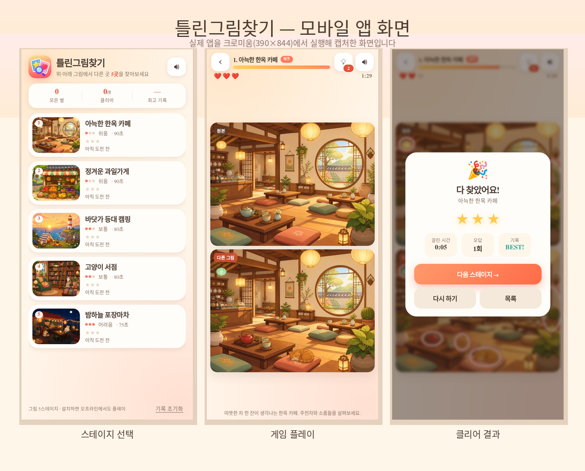
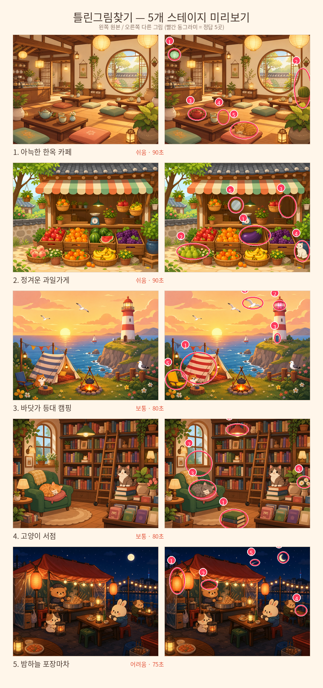

# 🔍 틀린그림찾기 — 찾아라, 다섯 곳!

아기자기한 일러스트에서 **위·아래 두 그림의 다른 곳 5곳**을 찾는 모바일 캐주얼 게임입니다.
설치 없이 웹에서 바로 즐길 수 있고(PWA), 원하면 같은 코드로 **안드로이드 앱(APK/AAB)** 을 클라우드에서 자동 빌드해 스토어에 올릴 수 있습니다.



| 항목 | 내용 |
| --- | --- |
| 스테이지 | 5개 (한옥 카페 · 과일가게 · 등대 캠핑 · 고양이 서점 · 포장마차) |
| 한 판 규칙 | 제한 시간 90/90/80/80/75초 · 하트 3개 · 힌트 2회 · 오답 시 −5초 |
| 기술 | 순수 HTML5 + CSS3 + Vanilla JS (프레임워크·번들러·CDN 없음) |
| 앱 패키징 | Capacitor 6 + GitHub Actions (APK / AAB 자동 빌드) |
| 오프라인 | 서비스 워커(`sw.js`)로 첫 방문 뒤 완전 오프라인 플레이 |
| 기록 저장 | `localStorage` — 스테이지별 별점·최고 기록 |

---

## 0. 바로 실행해 보기

폴더에서 정적 서버만 띄우면 됩니다. (파일을 더블클릭해 `file://` 로 열면 서비스 워커·이미지 경로 문제로 정상 동작하지 않습니다.)

```bash
# 파이썬이 있으면 이 한 줄이면 충분합니다
python3 -m http.server 8080
# → 폰/PC 브라우저에서 http://localhost:8080 접속
```

Node가 있다면 `npm run serve` 도 같은 일을 합니다.

---

## 1. 웹(PWA) 배포 — 1분이면 끝

이 저장소의 **루트 폴더가 곧 웹사이트**입니다. 빌드 과정이 없어서 정적 호스팅에 그대로 올리면 됩니다.

### 방법 A. Vercel (가장 빠름, 무료)

1. <https://vercel.com> 로그인 → **Add New… → Project**
2. 이 프로젝트를 GitHub에 올린 뒤 저장소를 선택 (또는 Vercel 화면에 폴더를 드래그&드롭)
3. Framework Preset: **Other**, Build Command: **비워둠**, Output Directory: **비워둠** → **Deploy**
4. 나온 주소(`https://내앱.vercel.app`)를 폰에서 열면 바로 게임이 실행됩니다.

### 방법 B. GitHub Pages (이미 워크플로가 들어 있습니다)

1. GitHub에 저장소를 만들고 이 폴더를 푸시 (기본 브랜치 이름이 `main`이 아니면 `.github/workflows/*.yml` 의 `branches:` 를 바꿔 주세요)
2. 저장소 **Settings → Pages → Source: GitHub Actions** 선택
3. `Deploy PWA to GitHub Pages` 워크플로가 자동 실행되고, 1~2분 뒤
   `https://<아이디>.github.io/<저장소>/` 에서 열립니다.

### 방법 C. Netlify / Cloudflare Pages

- Netlify: 사이트 폴더를 드래그&드롭 (Build command 없음, Publish directory `/`)
- Cloudflare Pages: 저장소 연결 → Framework preset **None**, Build output directory `/`

### 폰 홈 화면에 앱처럼 설치

> ⚠️ PWA 설치는 **https 주소**에서만 됩니다(localhost 예외). 위 방법으로 배포한 주소를 사용하세요.

- **안드로이드(Chrome)**: 주소창 오른쪽 ⋮ → **앱 설치** / **홈 화면에 추가** → 아이콘이 생기고 전체 화면으로 실행
- **아이폰(Safari)**: 하단 **공유** 버튼 → **홈 화면에 추가** → 홈 화면 아이콘으로 실행
- 한 번 열어 두면 서비스 워커가 그림까지 모두 캐시해서 **비행기 모드에서도** 플레이됩니다.

---

## 2. 안드로이드 앱 만들기 (APK · Play 스토어 AAB)

로컬에 Node/Android SDK가 없어도 됩니다. **GitHub Actions가 클라우드에서 빌드**합니다.

### 2-1. 자동 빌드 (권장)

1. 이 폴더를 GitHub 저장소에 푸시합니다. (`.github/workflows/build-android.yml` 포함)
2. **Actions** 탭 → `Build Android App (APK + AAB)` 실행 (푸시하면 자동, 또는 **Run workflow** 버튼)
3. 5~10분 뒤 실행 화면 아래 **Artifacts** 에서 `spot-the-difference-android` 를 내려받습니다.

| 파일 | 용도 |
| --- | --- |
| `spot-difference-debug.apk` | 폰에 바로 설치해 보는 **테스트용** (디버그 서명) |
| `spot-difference-release.apk` | 릴리스 키로 서명한 APK (직접 배포용) |
| `spot-difference-release.aab` | **Google Play 스토어 업로드용** 번들 |

**폰에 APK 설치**: 파일을 폰으로 옮긴 뒤 열고, "출처를 알 수 없는 앱 설치 허용"을 한 번 켜 주면 됩니다.

### 2-2. 스토어 업로드용 서명 키 등록 (Play 배포 시 필수)

키스토어 시크릿이 없으면 워크플로가 **임시 키**로 서명합니다. 임시 키는 테스트 설치에는 충분하지만, Play에 올린 뒤에는 **같은 키로 계속 올려야** 하므로 반드시 본인 키를 만들어 시크릿에 넣어 주세요.

```bash
# 1) 업로드 키 만들기 (딱 한 번, 안전한 곳에 보관)
keytool -genkeypair -v -keystore spotdiff-release.keystore \
  -alias spotdiff -keyalg RSA -keysize 2048 -validity 10000

# 2) base64 문자열로 변환 (macOS는: base64 -i spotdiff-release.keystore | tr -d '\n')
base64 -w0 spotdiff-release.keystore > keystore.b64
```

GitHub 저장소 → **Settings → Secrets and variables → Actions → New repository secret** 에 4개를 등록합니다.

| Secret 이름 | 값 |
| --- | --- |
| `ANDROID_KEYSTORE_BASE64` | `keystore.b64` 파일 내용 전체 |
| `ANDROID_STORE_PASSWORD` | 키스토어 비밀번호 |
| `ANDROID_KEY_ALIAS` | `spotdiff` (위 명령에서 정한 alias) |
| `ANDROID_KEY_PASSWORD` | 키 비밀번호 |

> `*.keystore`, `*.jks` 는 `.gitignore` 에 걸려 있어 실수로 커밋되지 않습니다.

### 2-3. Google Play 등록 순서

1. <https://play.google.com/console> 에서 앱 만들기 (앱 이름·기본 언어·게임 카테고리)
2. **앱 ID는 반드시 고유해야 합니다.** 지금은 `com.spotdiff.game` 으로 되어 있으니, 배포 전에
   `capacitor.config.json` 의 `appId` 를 본인 것으로 바꾸고 다시 빌드하세요. (예: `com.mycompany.spotdiff`)
3. **프로덕션 → 앱 번들** 에서 `spot-difference-release.aab` 업로드 → 출시 노트 작성
4. 스토어 등록정보(아이콘 512×512, 스크린샷, 설명)를 채우고 심사 제출
   - 아이콘: `icons/icon-512.png` 사용
   - 스크린샷: `downloads`/`assets/preview.png` 를 참고해 실제 폰 화면을 캡처해 사용

### 2-4. 내 PC에서 직접 빌드하고 싶다면

```bash
npm install
npm run cap:copy          # 루트의 웹 앱을 www/ 로 복사
npx cap add android       # android/ 프로젝트 생성 (최초 1회)
npx cap sync android
cd android && ./gradlew assembleDebug     # APK: app/build/outputs/apk/debug/
```

Android Studio로 열려면 `npm run android` (SDK가 설치되어 있어야 합니다).

---

## 3. 게임 방법과 기능

- **스테이지 선택**: 카드에 썸네일·난이도·획득 별점(★★★)·최고 기록이 표시되고 `localStorage` 에 저장됩니다.
- **플레이**: 위(원본)/아래(다른 그림)를 번갈아 보며 다른 곳을 탭합니다.
  - 정답: 양쪽 그림에 **부드러운 정답 동그라미**가 생기고 "딩동" 소리 + 짧은 진동
  - 오답: 붉은 **✕ 애니메이션** + 흔들림, 하트 1개와 시간 5초 차감
  - 이미 찾은 곳을 다시 눌러도 벌점은 없습니다.
- **힌트 💡**: 스테이지당 2회. 아직 못 찾은 곳 하나를 양쪽에 점선 원으로 3초간 보여 주고, 대신 5초를 씁니다.
- **HUD**: 스테이지명 · 찾은 개수(0/5) · 제한 시간 바 · 하트 3개 · 힌트 · 사운드 토글 · 뒤로가기
- **결과**: 클리어 시 별점(오답 수·남은 시간 기준)·소요 시간·BEST 갱신 표시, "다음 스테이지 / 다시 하기 / 목록"
  시간 초과 또는 하트 소진 시 "다시 도전" 모달
- **사운드**: Web Audio API로 **실시간 합성**(정답 딩동·오답·힌트·클리어 팡파르·게임오버). mp3 파일이 필요 없습니다.
- **진동**: `navigator.vibrate` (지원 기기에서만)
- **오프라인**: 첫 방문 후 모든 그림과 코드가 캐시되어 네트워크 없이 실행
- **앱 전환 대응**: 화면을 벗어나면 타이머가 자동으로 멈춥니다.

---

## 4. 스테이지와 정답 5곳

정답 좌표는 AI 편집본을 **픽셀 단위로 검증**해 확정한 값입니다(`stages.js` 의 `spots`).

| # | 스테이지 | 난이도 / 시간 | 다른 곳 5곳 |
| --- | --- | --- | --- |
| 1 | 아늑한 한옥 카페 | 쉬움 · 90초 | 종이등이 초록색 / 화분이 선인장으로 / 주전자가 빨간색 / 탁자 위 꽃병이 사라짐 / 쿠션 위에 고양이가 등장 |
| 2 | 정겨운 과일가게 | 쉬움 · 90초 | 수박이 가지로 / 매달린 바나나가 사라짐 / 시계가 거울로 / 의자에 흰 고양이 / 복숭아 바구니가 배로 |
| 3 | 바닷가 등대 캠핑 | 보통 · 80초 | 텐트가 빨간 줄무늬 / 등대 불빛이 분홍 / 등대 문이 파란색 / 하늘에 갈매기 한 마리 추가 / 캠핑 의자가 노란색 |
| 4 | 고양이 서점 | 보통 · 80초 | 고양이가 회색으로 / 창가 화분이 사라짐 / 갓등이 빨간색 / 바닥에 책 세 권이 쌓임 / 튤립이 흰 데이지로 |
| 5 | 밤하늘 포장마차 | 어려움 · 75초 | 등 하나 추가 / 사장님 모자가 빨간색 / 보름달이 초승달로 / 오른쪽 테이블 소품이 사라짐 / 별똥별이 생김 |



---

## 5. 프로젝트 구조

```
.
├── index.html            # 게임 UI (홈 + 게임 화면, 모달)
├── styles.css            # 모바일 우선 스타일 (따뜻한 크림/코랄 테마)
├── app.js                # 게임 로직 · 타이머 · 힌트 · 효과음 · 기록 저장
├── stages.js             # 스테이지 5개 + 검증된 정답 좌표 (자동 생성)
├── manifest.json         # PWA 매니페스트 (설치 아이콘·테마)
├── sw.js                 # 서비스 워커 (오프라인 캐시)
├── images/
│   ├── stage_0X_a.webp   # 원본 그림 (800×600)
│   ├── stage_0X_b.webp   # 다른 그림
│   └── thumbs/           # 목록용 썸네일
├── icons/                # 192/512/maskable/apple-touch 아이콘
├── assets/
│   ├── stages/           # 원본 PNG 마스터 (stage_0X_a.png / stage_0X_b.png)
│   ├── icon/             # 아이콘 마스터
│   ├── preview.png       # 실제 앱 화면 캡처
│   └── stages_sheet.png  # 스테이지 검수 시트 (정답 표시)
├── scripts/              # 이미지 생성·검증·배포 보조 스크립트 (아래 6장)
├── .github/workflows/
│   ├── build-android.yml # APK + AAB 자동 빌드
│   └── deploy-pages.yml  # GitHub Pages 자동 배포
├── package.json
└── capacitor.config.json # Capacitor 설정 (webDir: www)
```

> `www/` 폴더는 `npm run cap:copy` 로 생성되는 안드로이드용 사본입니다(저장소에는 올리지 않습니다).

---

## 6. 그림과 좌표를 다시 만들고 싶다면

`scripts/` 안의 파이썬 스크립트가 이 프로젝트의 이미지 파이프라인입니다. (Pillow, numpy, opencv-python 필요)

| 스크립트 | 하는 일 |
| --- | --- |
| `analyze_diff.py` | 두 이미지의 픽셀 차이를 계산해 "몇 곳이 다른지" 영역으로 보고 |
| `build_stage_b.py` | AI 편집본에서 **의도한 5곳만** 원본에 합성해 `stage_0X_b.png` 생성 후 5개 영역인지 자동 검증 |
| `gen_stages.py` | 검증 결과로 `stages.js` 의 좌표(`x, y, rx, ry`) 생성 |
| `review_sheet.py` | 원본/수정본 + 정답 원이 그려진 검수 시트 생성 |
| `make_icons.py` | 아이콘 마스터에서 192/512/maskable/apple-touch 생성 |
| `make_deliverables.py` | 배포용 미리보기 이미지 생성 |
| `shoot.py` | 실제 앱을 헤드리스 크로미움으로 실행해 화면 캡처 + 오프라인 동작 확인 |
| `copy-web.js` | 웹 앱을 `www/` 로 복사 (Capacitor 빌드용) |
| `patch_android_signing.py` | Capacitor가 만든 Gradle 파일에 릴리스 서명 설정 추가 |

**좌표를 옮기고 싶을 때**: `stages.js` 의 `x, y`(중심), `rx, ry`(반지름)는 모두 이미지 폭/높이에 대한 비율(0~1)입니다. 값을 바꾸면 판정과 정답 원이 함께 따라갑니다.

---

## 7. 규칙·디자인 바꾸기

| 바꾸고 싶은 것 | 위치 |
| --- | --- |
| 제한 시간·난이도·설명 | `stages.js` 의 `time`, `difficulty`, `desc` |
| 하트 개수 / 힌트 횟수 | `app.js` `startGame()` 의 `hearts: 3`, `hintsLeft: 2` |
| 오답 페널티(초) | `app.js` `onPanelTap()` 의 `timeLeft - 5` |
| 별점 기준 | `app.js` `starsFor()` |
| 색상 테마 | `styles.css` 상단 `:root` 변수 |
| 앱 이름·아이콘 | `manifest.json`, `capacitor.config.json`, `icons/` |

---

## 8. 검증 결과

- **픽셀 차이 검증**: 5개 스테이지 모두 원본/수정본을 800×600으로 맞춰 비교한 결과 **정확히 5개**의 분리된 차이 영역이 검출되었습니다. AI 편집이 배경 전체를 미세하게 다시 그리는 문제는, 의도한 영역만 원본에 합성하는 방식(`build_stage_b.py`)으로 제거했습니다.
- **좌표 정확도**: 정답 원 좌표는 위 검증에서 실제로 달라진 픽셀 영역에서 계산했고, 검수 시트(`assets/stages_sheet.png`)로 눈으로 확인했습니다.
- **실행 검증**: 헤드리스 크로미움(390×844, 375×667, 430×932)에서 콘솔 오류 0건, 서비스 워커 등록·**오프라인 재실행 성공**, 정답/오답/힌트/클리어/게임오버 모달 동작 확인.

---

## 9. 참고

- 그림과 아이콘은 AI로 생성한 뒤 검수·보정한 이미지입니다. 스토어 등록 시 직접 촬영·제작한 자료가 필요하면 같은 구조로 교체하면 됩니다(파일명과 크기만 유지).
- `appId`(`com.spotdiff.game`)는 Play 등록 전에 반드시 고유한 값으로 바꿔 주세요.
- 이 프로젝트는 MIT 라이선스로 자유롭게 사용·수정할 수 있습니다.
